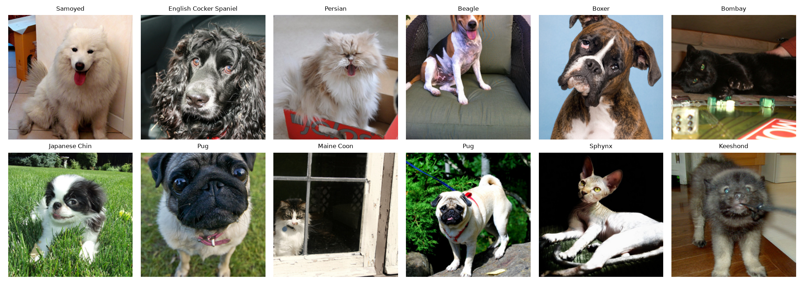
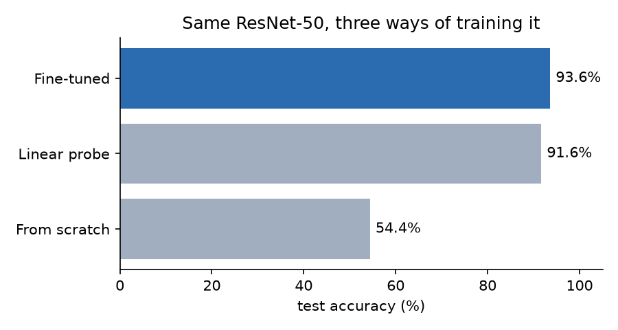
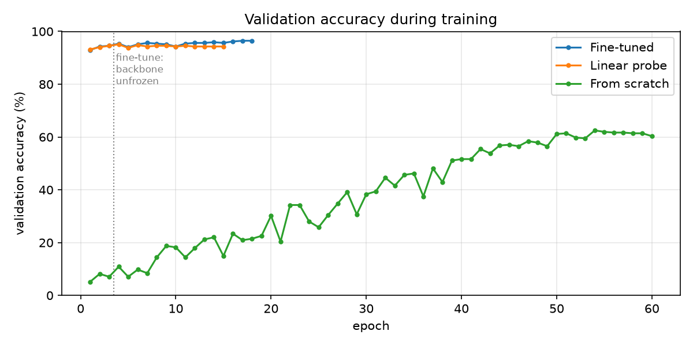
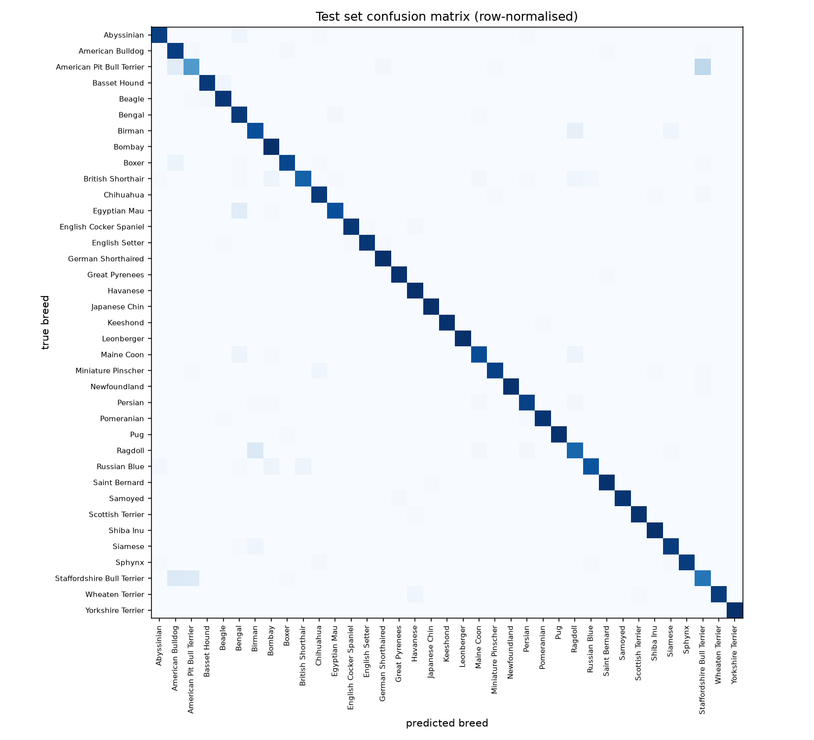
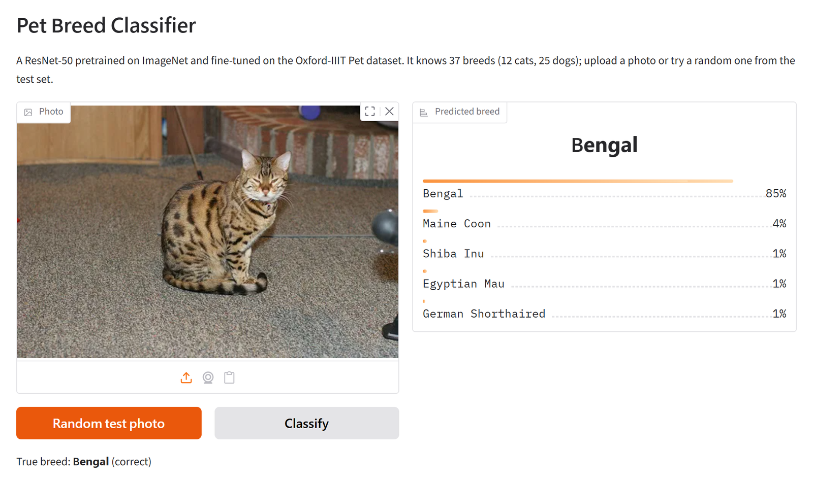

# Pet Breed Classifier

[](https://github.com/Gauhet/pet-breed-classifier/actions/workflows/tests.yml)

Identifies 37 cat and dog breeds from a photo by fine-tuning an ImageNet-pretrained ResNet-50
on the [Oxford-IIIT Pet](https://www.robots.ox.ac.uk/~vgg/data/pets/) dataset. It reaches
**93.6% test accuracy** (99.4% top-5) after about 5 minutes of training on a laptop GPU.

The same network trained from random weights only gets to 54.4%, and most of the project is
about why: it compares three ways of training the same model and writes the training
callbacks (early stopping, checkpointing) from scratch.



## Results

All three runs use the same ResNet-50, data, augmentation and seed. Only the starting weights
and which layers are allowed to learn change.

| | Test accuracy | Top-5 | Trainable parameters | Training time |
|-|-|-|-|-|
| **Fine-tuned** (pretrained, all layers) | **93.6%** | 99.4% | 23.6M | 5.4 min |
| Linear probe (pretrained, head only) | 91.6% | 99.9% | 75,813 | 3.3 min |
| From scratch (random weights) | 54.4% | 85.5% | 23.6M | 16.1 min |

<sub>Test set: 3,669 photos the models never saw during training or model selection. RTX 4050 Laptop GPU.</sub>



What the comparison shows:

- **Pretraining does most of the work.** Training only the final layer on top of frozen ImageNet
  features already gives 91.6%, and it got to 93% validation accuracy after a single epoch.
  Features learned for ImageNet (fur texture, ear and snout shapes, faces) transfer directly to
  telling breeds apart.
- **Fine-tuning adds the last couple of points.** Letting all layers adapt, with a learning rate
  10× smaller than the head's, adds 2 points of top-1 accuracy.
- **3,300 training photos aren't enough to learn from scratch.** The randomly initialised network
  needed 60 epochs to reach 54%. The training curves below show it still climbing slowly while
  the pretrained models had finished.



### Where the fine-tuned model goes wrong

Seven breeds are classified perfectly. The mistakes are concentrated in a few pairs of breeds
that look alike:

| True breed | Predicted as | Test photos |
|-|-|-|
| American Pit Bull Terrier | Staffordshire Bull Terrier | 27 of 100 |
| Ragdoll | Birman | 14 of 100 |
| Staffordshire Bull Terrier | American Bulldog | 12 of 89 |
| Egyptian Mau | Bengal | 11 of 97 |

American Pit Bull Terriers and Staffordshire Bull Terriers are closely related and have very
similar builds and coats, so the model's worst class (pit bull terrier, 58%) is mostly this one
confusion. Ragdolls and Birmans are both long-haired, colour-pointed cats with blue eyes.



## How it works

**Two-stage fine-tuning** ([`train.py`](src/pet_classifier/train.py)). The ImageNet head is
replaced by a new 37-way linear layer, which starts out random. For the first 3 epochs the rest
of the network is frozen and only the head trains (learning rate 1e-3); unfreezing straight away
would send large, noisy gradients from the random head into the pretrained layers. Then every
layer is unfrozen and training continues at 1e-4. Both stages use AdamW, a cosine learning-rate
decay, label smoothing (0.1) and mixed precision.

**Callbacks** ([`callbacks.py`](src/pet_classifier/callbacks.py)). The trainer calls a list of
callback objects after every epoch:

- `ModelCheckpoint` saves the model whenever validation accuracy reaches a new best. It keeps
  its record across both stages, so the saved file is the best model from either stage.
- `EarlyStopping` stops a stage once validation loss has gone a set number of epochs without
  improving, and resets between stages. In these runs it never triggered, because validation loss
  was still slowly improving at the end of each schedule. The checkpoint picked the best epoch.

Both build on a small `BestTracker` that knows whether a metric should go up or down. The
callback logic has its own unit tests.

**Frozen batch norm** ([`engine.py`](src/pet_classifier/engine.py)). Freezing a layer's weights
doesn't stop its batch-norm layers from updating their running mean and variance in training
mode. The trainer keeps frozen batch-norm layers in eval mode, so the linear probe really does
use the original ImageNet statistics.

**Data** ([`data.py`](src/pet_classifier/data.py)). The official 3,680-photo training split is
divided 90/10 into training and validation with a fixed seed, and the official 3,669-photo test
split is used only once, at the end. Training photos get random resized crops (keeping at least
35% of the image, since breeds differ in small details), horizontal flips and mild colour
changes. Evaluation uses the standard resize-to-256, centre-crop-to-224 pipeline.

## Running it

Requires Python 3.10+. Install PyTorch for your hardware first
([pytorch.org](https://pytorch.org/get-started/locally/)), then the package:

```bash
git clone https://github.com/Gauhet/pet-breed-classifier.git
cd pet-breed-classifier
pip install -e ".[dev]"
```

Train (the dataset, about 790 MB, downloads on the first run):

```bash
python -m pet_classifier.train --mode finetune
python -m pet_classifier.train --mode linear
python -m pet_classifier.train --mode scratch
```

Evaluate every trained model on the test set and regenerate the figures in `assets/`:

```bash
python -m pet_classifier.evaluate
```

Name the breed in your own photos:

```bash
python -m pet_classifier.predict my_dog.jpg
```

Or try it in the browser: a small Gradio app lets you upload a photo or pull a random test photo
and compare the prediction with the true breed.

```bash
pip install -e ".[demo]"
python app.py   # then open http://localhost:7860
```



Run the tests:

```bash
pytest
```

Every script takes `--help` for its options (architecture, epochs, learning rates, patience and
so on).

## Project layout

```
src/pet_classifier/
  data.py        dataset download, augmentation, train/val split
  model.py       ResNet construction, freezing, checkpoint save/load
  callbacks.py   EarlyStopping, ModelCheckpoint and the BestTracker they share
  engine.py      Trainer: the training loop that runs the callbacks
  train.py       training command (finetune / linear / scratch)
  evaluate.py    test-set metrics, model comparison and figures
  predict.py     predictions on your own photos
app.py           browser demo (Gradio)
tests/           callback, model, data and training-loop checks
results/         training history, metrics and logs for each run above
assets/          figures used in this README
```

## What I'd try next

- Discriminative learning rates (smaller for early layers, larger for later ones) instead of a
  single fine-tuning rate.
- A stronger backbone such as ConvNeXt-Tiny or a ViT, which should push past 95%.
- Test-time augmentation (averaging predictions over flipped and cropped versions of each photo),
  which usually helps most on exactly the look-alike pairs above.

## Background

I first worked on transfer learning and training callbacks in WorldQuant University's *Deep
Learning for Computer Vision* lab. This repository is my own implementation on a public dataset,
written from scratch; it contains no course material.

## License

[MIT](LICENSE)
